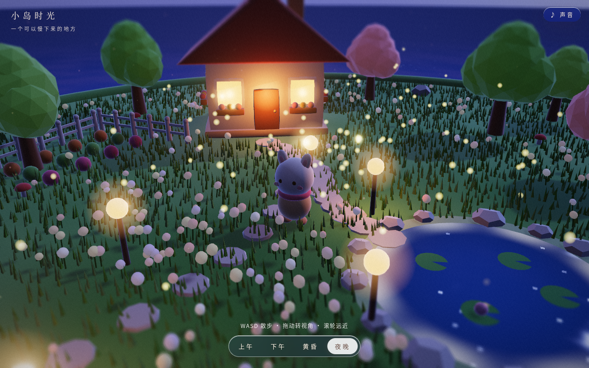
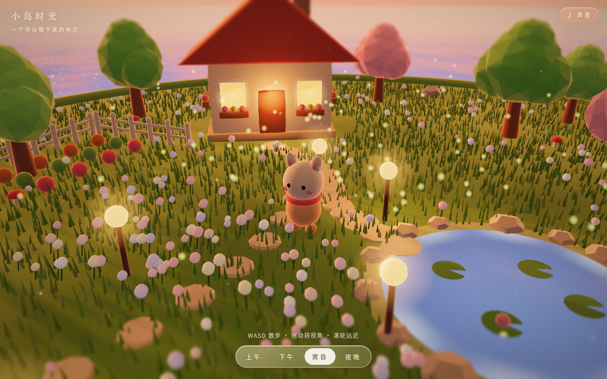
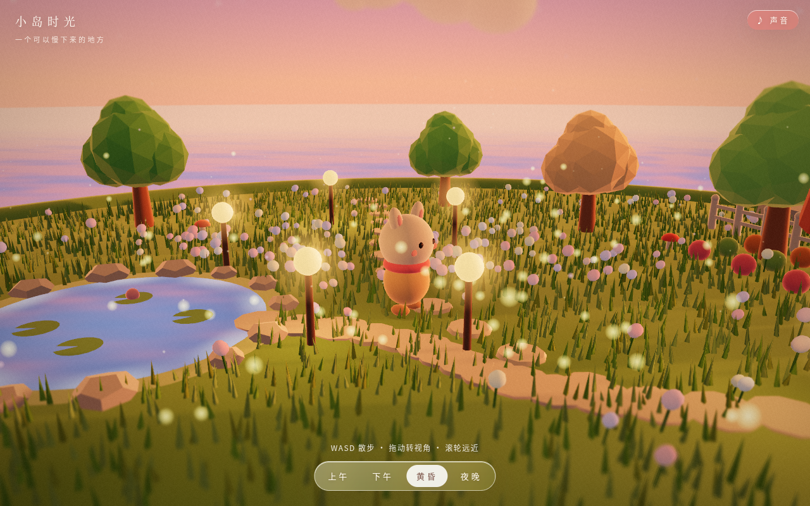
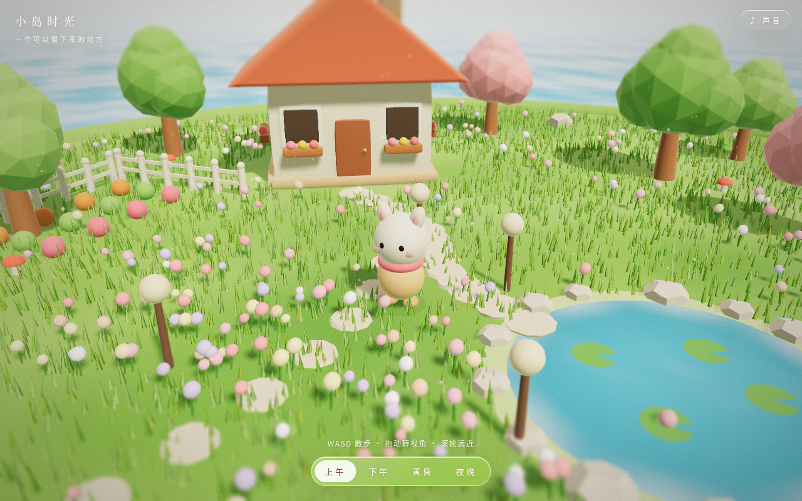
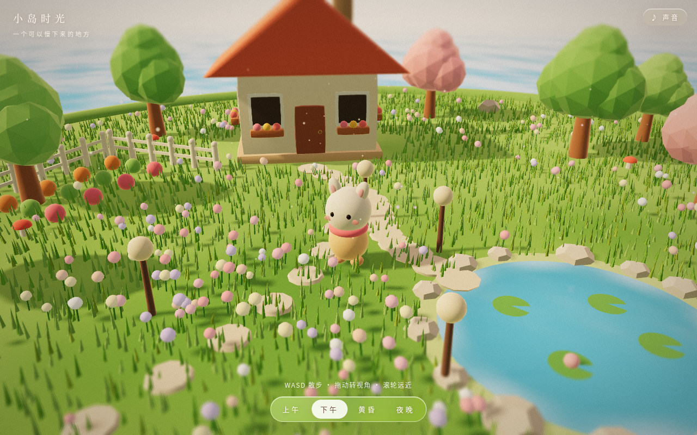
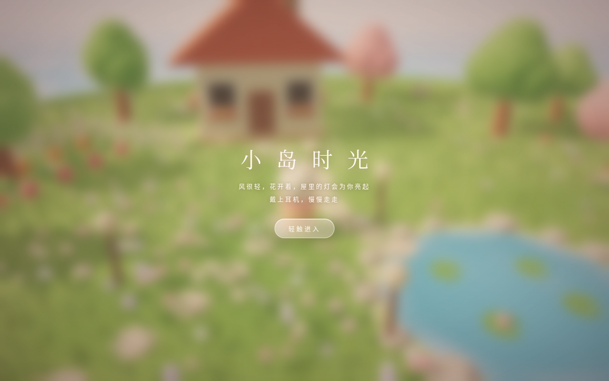
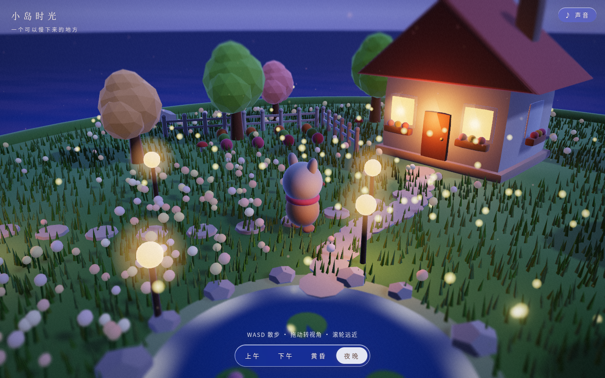
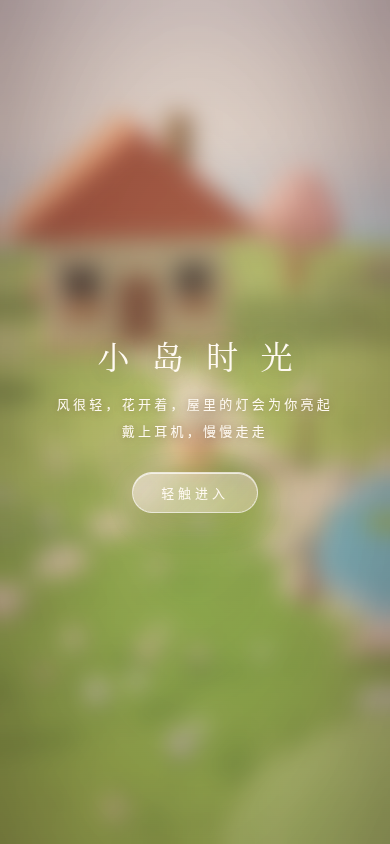
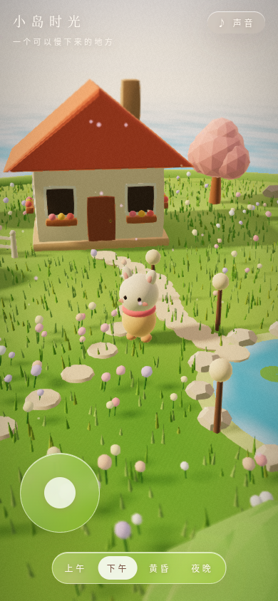
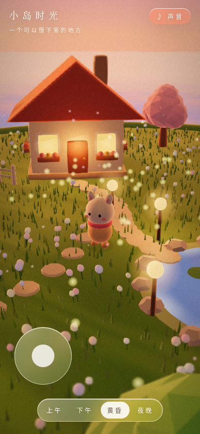

# 小岛时光 · Island Time

> 一个可以慢下来的地方。（v2：更柔的光、会发光的水面与灯笼、聪明的镜头）
> 风很轻，花开着，屋里的灯会为你亮起——戴上耳机，慢慢走走。



| 黄昏 | 散步转视角 |
|---|---|
|  |  |

🌐 在线体验：<https://marsresearcher.github.io/island-time/>

**English summary:** *Island Time* is a cozy, low-poly 3D walkable healing scene built with three.js. Stroll a small floating island with a cottage, pond, trees, flowers, lanterns and a bench as a little bunny-like character. No score, no timer, no goals. Switch between morning / afternoon / dusk / night with smooth lighting transitions, and listen to fully procedural Web Audio music, birdsong, insects and footsteps. Runs offline from `index.html` (bundled into `cozy.js`). MIT licensed.

---

## 怎么玩

1. 打开在线地址，或**双击 `index.html`**（代码已打包进 `cozy.js`，`file://` 直接运行，无需联网和服务器）。
2. 建议戴上耳机，**轻触进入**。
3. 随便走走，没有目标，也不会结束。

## 操作

| 操作 | 桌面端 | 移动端 |
|---|---|---|
| 散步 | `WASD` / 方向键 | 左下角虚拟摇杆 |
| 转视角 | 鼠标拖动 | 单指拖动画面 |
| 远近 | 鼠标滚轮 | — |
| 切换时间 | 底部按钮 **上午 / 下午 / 黄昏 / 夜晚** | 同左 |
| 声音 | 右上角 **♪ 声音 / 静音** | 同左 |

## 截图（v2）

| 上午 | 下午 | 黄昏 | 夜晚 |
|---|---|---|---|
|  |  |  |  |

| 开始 | 散步转视角 | 夜里的小屋 |
|---|---|---|
|  |  |  |

移动端（竖屏）：

| 开始 | 下午 | 黄昏 |
|---|---|---|
|  |  |  |

## 本地运行 / 开发

```bash
# 直接玩：双击 index.html 即可
# 修改源码后重新打包：
npm install
npm run build        # esbuild src/main.js → cozy.js
# 重新截图（需要本机 Chrome；可用 CHROME_PATH、SHOTS_DIR 覆盖默认值）：
CHROME_PATH=/path/to/chrome npm run shots   # v2 截图 → shots/v2/
```

## 目录

```
index.html   页面与 UI（毛玻璃按钮、开始遮罩）
cozy.js      打包后的完整程序（three.js 已内置）
src/main.js  源码：场景、光照、时间、音频、输入
shot.mjs     v1 截图脚本
shot2.mjs    v2 截图脚本
shots/       截图（v1 在根目录，v2 在 shots/v2/）
DESIGN.md    设计说明
```

更多设计思路见 [DESIGN.md](DESIGN.md)。

## 许可

[MIT](LICENSE) © 2026 MarsResearcher
